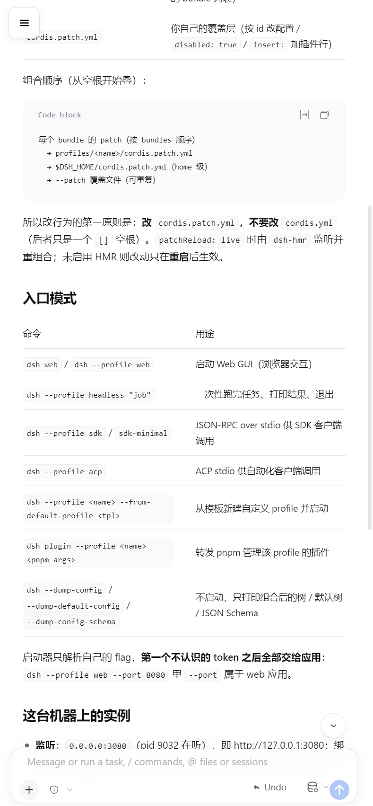
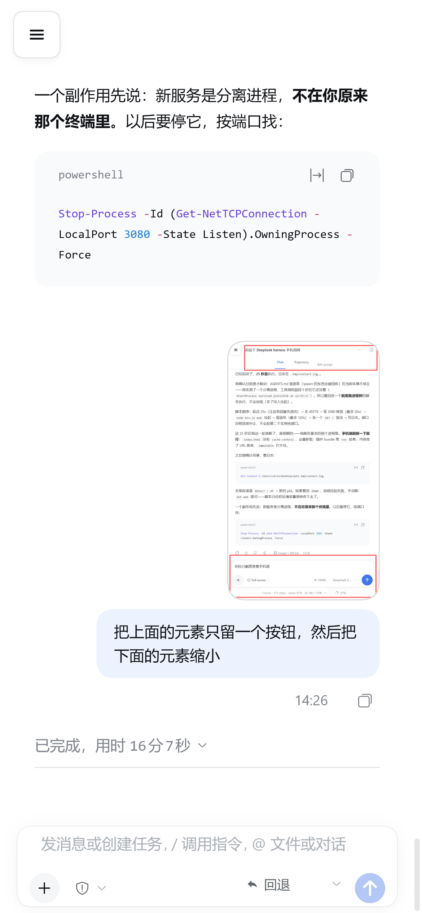
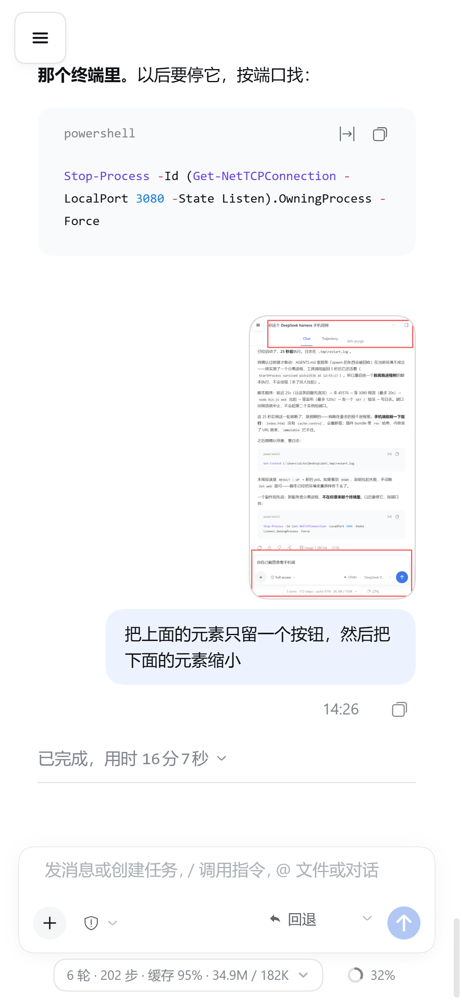

# dsh-mobile-slim

**极简手机版 DSH 插件** — 把 DeepSeek Harness Web GUI 在手机上压缩到只剩必要元素。

[](https://github.com/deepseek-ai)
[](./LICENSE)

> A minimal mobile layout patch for the DeepSeek Harness Web GUI: a hamburger-only
> header, a translucent composer that collapses on its own, and no sticky code-block
> banner eating your first line of code.
>
> Works on top of [`dsh-client-ui-mobile-adapt`](https://github.com/Hotsteel2901/dsh-client-ui-mobile-adapt)
> — it does not replace it.



---

## 它解决什么问题

官方 Web GUI（配合 mobile-adapt）在手机上仍然偏"桌面"：顶栏占 76px 只为了显示一个会话标题和三个按钮，底栏占 130px 常驻统计条，代码块标题栏还会吸顶压住正文。6 英寸屏上，这些加起来的 200+px 全是纯开销。

这个插件把上述部分压到接近零，并且**不牺牲可操作性**——需要的信息仍然点得到，只是不再常驻。

## 改了什么

### 顶栏：只留汉堡

- 会话标题、面包屑、tabs、右上角全部移除
- `wSkVaW_header` 高度 **76px → 0**，那层不透明背景彻底消失
- 顶部留白改为加在**滚动容器内部**（`wSkVaW_scrollBody` 的 `padding-top`），滚动时留白跟着滚走，正文可以直接顶到屏幕最上沿、从汉堡背后滑过
- 汉堡本身改成半透明毛玻璃，正文从它背后经过时能透出来

### 底栏：收窄 + 半透明 + 交互收放

| 状态 | 高度 | 背景 | 统计条 |
|---|---|---|---|
| 默认 | 130px → **80px** | 半透明 82% + blur(16px) | 隐藏 |
| 点击展开 | 129px | 不透明 | 显示 |
| 手指滑动时 | **80px** | 半透明 | 隐藏 |

- "点击展开 / 滑动收窄"都是真实交互，不是静态样式
- 首页的空会话大输入框（`uV2eYG_hero`）排除在外，不参与收窄

<table>
<tr>
<td><br/><sub>默认：半透明收窄</sub></td>
<td><br/><sub>点击：展开并显示统计条</sub></td>
</tr>
</table>

### 代码块：标题栏不再吸顶

DSH 的代码块标题栏（语言标签 + 复制按钮）是 `position: sticky; top: 0; z-index: 6`。在带 `padding-top` 的滚动容器里，它的粘附位置会错位（实测停在 y≈32 而非对齐顶部），结果悬在正在滚动的代码内容上方，把第一行代码盖住，语言标签还紧贴汉堡。

手机屏窄、代码块也不长，吸顶收益不抵遮挡，这里直接退回普通文档流：

```css
[class*="_bannerWrap"] { position: static !important; top: auto !important; }
```

## 安装

本插件是**浏览器端（client-only）插件**，宿主侧不做任何事（`lib/index.js` 的 `apply()` 是空函数）。

```bash
# 1. 放进 profile 的 node_modules
cd ~/.dsh/profiles/web/node_modules
git clone https://github.com/zhang-lecheng/dsh-mobile-slim.git

# 2. 在 profile 的 cordis.patch.yml 里注册
cat >> ~/.dsh/profiles/web/cordis.patch.yml <<'YAML'
- insert:
    - id: ui-mobile-slim
      name: 'dsh-mobile-slim'
YAML

# 3. 重启
dsh web
```

> 本插件需要配合 `dsh-client-ui-mobile-adapt` 使用——汉堡按钮由它提供。
> 若未安装 mobile-adapt，本插件的样式仍会生效，但会失去移动端单列布局和侧栏抽屉。

## 四个踩过的坑（也是本插件的设计依据）

这些都是实测出来的，写在这里是因为它们对任何 DSH 客户端插件都成立。

### 1. 样式必须注入 `<body>`，不是 `<head>`

`dsh-client-ui-mobile-adapt` 用 `MutationObserver` 监听 `<head>` 的 `childList`，一旦发现自己的 `<style>` 不在末尾就 `appendChild` 搬回去。如果本插件也去抢 `<head>` 末尾，两者会形成**无限乒乓**——每轮都产生新的 mutation，把 `@deepseek-ai/dsh-client-shortcuts` 那个监听全文档的 observer 拖进风暴，boot 阶段主线程直接吃死，页面永远停在 `HARNESS / Loading plugins…`，Chrome 弹 "Page Unresponsive"。

四组对照实验（390×844）：

| 配置 | 挂载耗时 | DOM 元素 | 结果 |
|---|---|---|---|
| 都不开 | 3050 ms | 329 | 正常 |
| 只开本插件 | 3042 ms | 405 | 正常 |
| 只开 mobile-adapt | 3080 ms | 286 | 正常 |
| **两个都开（抢 head）** | **>126 s** | **9** | **死锁** |

正确做法：注入 `<body>`。文档顺序上 body 内的样式表永远排在 head 之内所有样式表之后，同特异性同 importance 时必胜，压根不需要抢。

### 2. 不能用 `:focus-within`

DSH 进入会话时会**自动聚焦**输入框，所以 `:focus-within` 恒为真，"默认收窄"永远压不住。改用 `<html>` 上的 class + `pointerdown` 驱动，并且 class 必须挂 `<html>`——挂 composer 自己身上会被 React 重渲染抹掉。

### 3. 不能用 `scroll` 事件判断"正在滑动"

页面自身会程序化滚动（自动滚到底、虚拟列表校正），一加载就永久处于"滚动中"，把展开态压死。改用 `touchmove` + `wheel`，只响应人真实的输入。

### 4. 顶部留白不能加在不滚动的那层

`wSkVaW_body` 是 `overflow: visible`、高度等于整屏的**外层**；真正滚动的是它里面的 `wSkVaW_scrollBody`。把 `padding-top` 加在外层，会变成一条**永久白带**压在正文上方（正文永远顶不上来）。必须加在滚动容器内部。

## 结构

```
dsh-mobile-slim/
├── cordis.patch.yml    # 注册到浏览器插件名册
├── lib/
│   ├── index.js        # 宿主侧入口（空实现）
│   └── client.js       # 全部逻辑：CSS + 三个事件监听
├── docs/               # 截图
└── package.json
```

全部逻辑集中在一个 `client.js` 里：一个 CSS 字符串 + `ensureLast()`（注入 `<body>`）+ `markScrolling()`（touchmove/wheel）+ `openComposer/closeComposerSoon`（pointerdown）。**没有 `MutationObserver`**，这是刻意的。

## 兼容性

- DSH `>= 0.2.0-rc.2 < 0.3.0`
- 类名基于 DSH `0.2.0-rc.2` 实测（`wSkVaW_*` / `uV2eYG_*` / `_bannerWrap_*` 等哈希前缀）。DSH 升级后类名若变化，样式会静默失效——届时需要重新核对选择器。

## License

[MIT](./LICENSE) © 2026 zhang-lecheng
